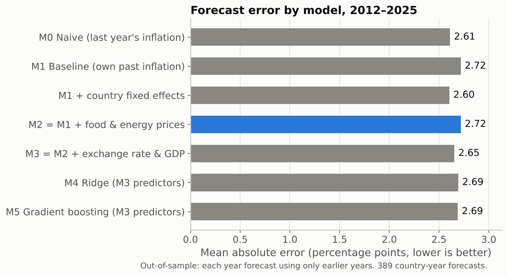

# Do global commodity prices help forecast inflation?

**Research question:** Do last year's changes in world food and energy prices improve
one-year-ahead inflation forecasts for developing and emerging economies, compared
with forecasts that use only each country's own past inflation?

## Short answer

**No, not in this data.** Across 28 developing and emerging economies, forecasting each
year from 2012 to 2025 using only earlier data, adding world food and energy price changes
(model M2) gave almost exactly the same average error as using past inflation alone
(model M1): a mean absolute error of **2.72 vs 2.72 percentage points**. M2 was better in
**14 of 28** countries and worse in the other 14, and a Diebold-Mariano test finds no
difference (**p = 0.99**).

Three more findings:

- A naive forecast ("inflation will be the same as last year") had a mean absolute error of
  **2.61**, about as good as any model. No model beat the baseline by a statistically clear margin.
- Food prices on their own helped slightly (**2.68** vs **2.72**, better in 22 of 28 countries),
  and energy prices on their own made forecasts slightly worse (**2.76**). The year-level test
  does not find either difference significant (p = 0.36 and p = 0.59).
- The relationship was unstable. Before 2022, past data suggested that higher energy prices
  were followed by *lower* inflation, so after energy prices jumped 81% in 2021 the
  commodity model forecast *less* inflation for 2022 than the baseline did.

## Key chart



## Key table

Out-of-sample forecasts for 2012–2025 (389 country-years). Errors are in percentage
points of inflation; lower is better.

| Model | Predictors (all from the year before) | MAE | RMSE | Median abs. error |
|---|---|---|---|---|
| M0 Naive | last year's inflation, unchanged | 2.61 | 4.91 | 1.40 |
| M1 Baseline | past inflation (linear regression) | 2.72 | 4.94 | 1.85 |
| M1 + fixed effects | past inflation + a separate intercept per country | 2.60 | 4.86 | 1.62 |
| **M2 Commodity** | **M1 + food and energy price changes** | **2.72** | **4.98** | **1.81** |
| M3 Extended | M2 + exchange-rate change + GDP growth | 2.65 | 4.85 | 1.77 |
| M4 Ridge | M3 predictors, penalised regression | 2.69 | 4.91 | 1.79 |
| M5 Gradient boosting | M3 predictors, tree model | 2.69 | 5.26 | 1.46 |

Source: `results/tables/oos_metrics_overall.csv`. Robustness checks (dropping very high
inflation, country fixed effects, two years of lags, leaving out 2020–2022, food vs energy)
are in [METHODS.md](METHODS.md). None shows a statistically clear gain from commodity prices.

## Data

- **World Bank World Development Indicators (API):** inflation (FP.CPI.TOTL.ZG),
  GDP growth (NY.GDP.MKTP.KD.ZG) and the official exchange rate (PA.NUS.FCRF), 2000–2025,
  for 28 countries from Central Asia to Latin America.
- **World Bank Commodity Price Data (the "Pink Sheet"):** monthly food, energy, agriculture
  and fertilizer price indices (nominal US dollars, 2010 = 100), turned into yearly averages.

Both were downloaded on 29 October 2026 and are licensed CC BY 4.0. Details, links and
citations are in [DATA_SOURCES.md](DATA_SOURCES.md).

## How to reproduce

Needs Python 3.10+ (results were produced with Python 3.13).

```bash
git clone https://github.com/idahler07-dev/ML-Project-.git
cd ML-Project-
python -m venv .venv
source .venv/bin/activate          # Windows: .venv\Scripts\activate
pip install -r requirements.txt
python run_all.py --no-download    # exact results, from the saved raw data
python -m pytest                   # leakage and evaluation tests
```

`python run_all.py` (without `--no-download`) downloads fresh data first. The World Bank
revises its data, so a later download can change the numbers slightly.

`src/` has one file per step; `results/tables/` holds every result as CSV.
[METHODS.md](METHODS.md) explains every choice; [LEARNING.md](LEARNING.md) explains the
project for a non-specialist.

## Limitations

- **Correlation is not causation.** This is a forecasting test, not a measure of how
  commodity prices *cause* inflation.
- **Small sample.** There are only 14 test years, and commodity prices are the same for
  every country in a given year, so there are few independent commodity "shocks" to learn from.
- **Shocks and structural breaks.** 2008, 2020 and 2021–2022 behaved very differently, and
  the estimated effects changed over time.
- **Data revisions.** We use today's revised data, not the numbers a forecaster had at the time.
- **Countries differ.** One shared model may not fit Turkiye, Ghana and Malaysia equally well.
- **Missing data.** Uzbekistan has inflation data only from 2011 and exchange-rate data only
  from 2013, so it enters the test from 2015.

## Citation

Please cite the project and the data:

> [Author name] (2026). *Do global commodity prices help forecast inflation?* GitHub
> repository, https://github.com/idahler07-dev/ML-Project-.

> World Bank (2026). *World Development Indicators* and *World Bank Commodity Price Data
> (The Pink Sheet)*. Washington, DC: The World Bank. CC BY 4.0.
